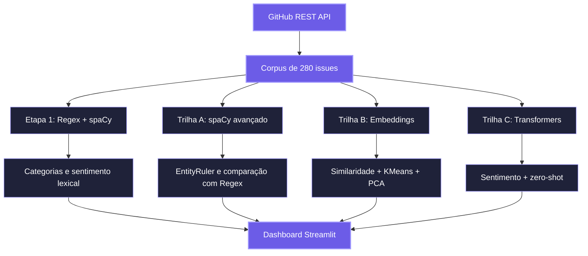
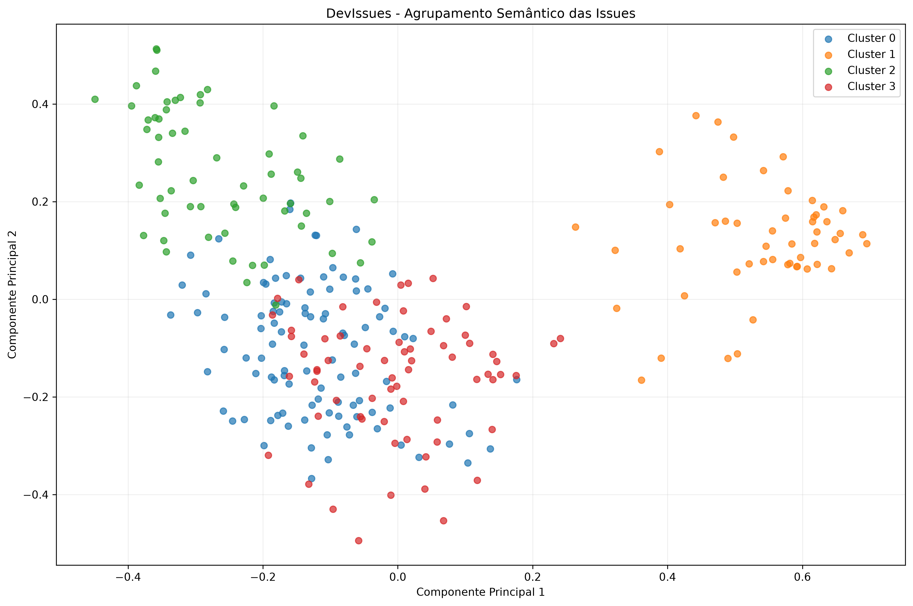
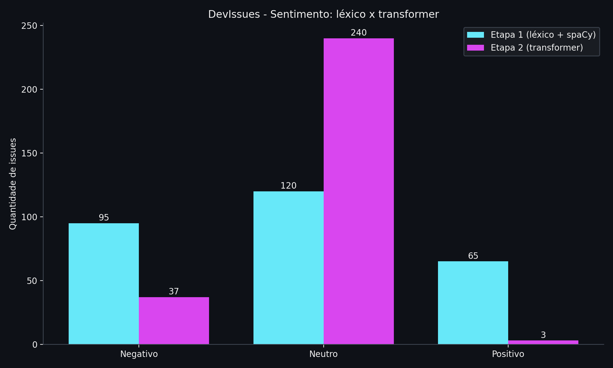

<div align="center">

# ✦ DevIssues

### Inteligência em cada issue.

**Do texto bruto à descoberta semântica — uma plataforma de análise de issues de projetos open source.**

<br>


<br>

**280 issues analisadas** · **4 repositórios** · **2 idiomas** · **3 trilhas de IA**

[Explorar o projeto](#-sobre-o-projeto) · [Resultados](#-resultados) · [Executar](#-como-executar) · [Diários de bordo](#-diários-de-bordo)

</div>

---

## ✦ Sobre o projeto

O **DevIssues** investiga como desenvolvedores descrevem problemas, solicitações de funcionalidades, dívida técnica e urgência nas *issues* de projetos de código aberto no GitHub.

Na primeira etapa, o projeto combinou **GitHub REST API, expressões regulares e spaCy** para coletar, processar e categorizar os relatos. Na segunda etapa, ampliou a análise com **pipelines linguísticos avançados, embeddings semânticos, clusterização e Transformers**.

> **Pergunta norteadora:** quais padrões linguísticos e semânticos podem ser identificados em relatos de problemas de software e como diferentes abordagens de NLP se comparam na análise dessas issues?

A aplicação utiliza os **textos das issues**, principalmente título e descrição. Ela **não analisa nem executa o código-fonte** dos repositórios estudados.

## ◈ O que a plataforma entrega

| Experiência | O que é possível explorar |
| :--- | :--- |
| **Visão geral** | Indicadores de bugs, funcionalidades, dívida técnica, urgência e sentimentos |
| **spaCy avançado** | Entidades de erros, versões, bibliotecas e tecnologias; comparação com Regex |
| **Embeddings** | Busca semântica em linguagem natural, quatro clusters e projeção PCA interativa |
| **Transformers** | Sentimento multilíngue, classificação zero-shot e comparação com a etapa inicial |

O dashboard é construído com **Streamlit e Plotly**, com navegação lateral e visualizações interativas. Os resultados pré-processados ficam disponíveis nos arquivos da pasta [`resultados/`](resultados/).

---

## ◈ Dataset

Os dados foram coletados pela **GitHub REST API** e armazenados em [`dados/issues.csv`](dados/issues.csv).

| Repositório | Issues | Idioma predominante |
| :--- | ---: | :--- |
| [`psf/requests`](https://github.com/psf/requests) | 70 | Inglês |
| [`pandas-dev/pandas`](https://github.com/pandas-dev/pandas) | 70 | Inglês |
| [`microsoft/vscode`](https://github.com/microsoft/vscode) | 70 | Inglês |
| [`filipedeschamps/tabnews.com.br`](https://github.com/filipedeschamps/tabnews.com.br) | 70 | Português |
| **Total** | **280** | **210 EN · 70 PT** |

A composição bilíngue orientou a escolha de modelos específicos por idioma na análise spaCy e de modelos multilíngues nas trilhas de embeddings e Transformers.

---

## ◈ Arquitetura de análise



### 01 · Fundamentos: Regex + spaCy

O pipeline inicial identifica referências a issues, URLs, arquivos, versões de software e nomes de exceções. O spaCy realiza tokenização, lematização, filtragem de *stopwords*, análise gramatical e reconhecimento de entidades. Essas informações são combinadas com as *labels* do GitHub para marcar **bugs, dívida técnica, pedidos de funcionalidade e urgência**, além de produzir uma classificação lexical de sentimento.

**Módulos:** [`src/regex.py`](src/regex.py), [`src/nlp.py`](src/nlp.py) e [`src/analise.py`](src/analise.py).

### 02 · Trilha A: spaCy avançado

A segunda etapa estende a análise linguística com **modelos médios do spaCy**, `EntityRuler`, ajuste de tokenização e componentes personalizados. O sistema extrai menções a erros, versões, bibliotecas e tecnologias; também compara essas extrações com o Regex e calcula vizinhanças semânticas **dentro de cada idioma**.

**Módulo:** [`src/pipeline_spacy.py`](src/pipeline_spacy.py).  
**Saídas:** `spacy_avancado.csv` e `spacy_vs_regex.csv`.

### 03 · Trilha B: embeddings e descoberta semântica

O modelo multilíngue **`paraphrase-multilingual-MiniLM-L12-v2`** transforma cada issue em um vetor de **384 dimensões**. A partir dessas representações, são realizadas:

- **Busca semântica:** comparação por similaridade do cosseno para recuperar as cinco issues mais próximas de uma consulta.
- **Agrupamento:** **KMeans com K = 4**, para explorar padrões temáticos.
- **Visualização:** **PCA** para projetar os vetores em duas dimensões.
- **Avaliação:** Silhouette Score, Davies-Bouldin, Calinski-Harabasz e leitura qualitativa de amostras.

**Módulo:** [`src/embeddings.py`](src/embeddings.py).  
**Saídas:** `embeddings.npy`, `embeddings_resultados.csv` e `clusters_pca.png`.

<div align="center">
  
  <br><sub>Projeção exploratória dos embeddings: a redução para 2D não preserva toda a informação do espaço original.</sub>
</div>

### 04 · Trilha C: Transformers

O pipeline usa o modelo **`cardiffnlp/twitter-xlm-roberta-base-sentiment`** para classificar sentimento em **negativo, neutro e positivo**, e **`MoritzLaurer/mDeBERTa-v3-base-xnli-multilingual-nli-2mil7`** para classificação *zero-shot* dos tipos de issue: bug, dívida técnica e pedido de funcionalidade.

As previsões são comparadas com as da etapa inicial. O código também inclui uma avaliação contra **rótulos humanos**, com acurácia e F1, mas essa avaliação depende da conclusão da rotulagem manual.

**Módulo:** [`src/transformers_sent.py`](src/transformers_sent.py).  
**Saídas:** `transformers_resultados.csv`, `transformers_vs_etapa1.csv` e gráficos de comparação.

<div align="center">
  
  <br><sub>Comparação de classificações automáticas; concordância entre métodos não equivale a acurácia.</sub>
</div>

---

## ◈ Resultados

### Panorama do corpus

| Indicador | Resultado |
| :--- | ---: |
| Issues analisadas | **280** |
| Repositórios | **4** |
| Bugs/erros identificados na etapa 1 | **147** |
| Pedidos de funcionalidade | **117** |
| Dívida técnica | **35** |
| Urgência explícita | **6 (2,1%)** |

Uma issue pode pertencer a mais de uma categoria, portanto as contagens **não são mutuamente exclusivas**.

### Agrupamento semântico

| Cluster | Issues | Leitura temática exploratória |
| :--- | ---: | :--- |
| 0 | 102 | Funcionalidades, configurações e integrações |
| 1 | 52 | Manipulação e conversão de dados no Pandas |
| 2 | 59 | Evolução de funcionalidades e experiência de uso |
| 3 | 67 | Correções, confiabilidade e compatibilidade |

Para **K = 4**, a análise registrou **Silhouette = 0,0886**, **Davies-Bouldin = 3,5811** e **Calinski-Harabasz = 18,6928**. As métricas indicam separação limitada entre grupos; os temas acima são interpretações qualitativas, não rótulos produzidos automaticamente pelo KMeans.

Além disso, a associação entre **cluster e idioma (V de Cramér = 0,707)** e entre **cluster e repositório (V = 0,695)** recomenda cautela ao atribuir os agrupamentos apenas à semântica dos textos.

### Comparações entre métodos

A Trilha A registrou concordância na detecção de erros entre Regex e spaCy em **42 issues com erros** e **238 sem erros** após ajustes na tokenização. A comparação de versões ainda apresenta divergências associadas às regras e ao contexto utilizado por cada método.

Na Trilha C, as diferenças de sentimentos entre métodos são exploradas em [`resultados/transformers_vs_etapa1.csv`](resultados/transformers_vs_etapa1.csv). **A avaliação de desempenho contra a rotulagem humana ainda não está concluída.**

---

## ◈ Como executar

### 1 · Clonar o projeto e preparar o ambiente

```bash
git clone https://github.com/Clarareis03/DevIssues.git
cd DevIssues
python -m venv .venv
```

Ative o ambiente virtual:

**Windows (PowerShell)**

```powershell
.\.venv\Scripts\Activate.ps1
```

**Windows (Git Bash)**

```bash
source .venv/Scripts/activate
```

**Linux / macOS**

```bash
source .venv/bin/activate
```

Instale as dependências:

```bash
python -m pip install -r requirements.txt
```

> O primeiro carregamento dos modelos Transformers ou Sentence Transformers pode baixar arquivos adicionais e exigir memória e conexão com a internet. Para apenas explorar os resultados salvos, não é necessário reprocessar os modelos.

### 2 · Abrir o dashboard

```bash
python -m streamlit run app.py --server.port 8502
```

Acesse **http://localhost:8502**. A porta `8502` é usada aqui para evitar conflito com outra aplicação local; você pode alterá-la conforme necessário.

### 3 · Reproduzir os pipelines (opcional)

Baixe os modelos spaCy adequados antes de reprocessar:

```bash
python -m spacy download en_core_web_sm
python -m spacy download pt_core_news_sm
python -m spacy download en_core_web_md
python -m spacy download pt_core_news_md
```

| Objetivo | Comando |
| :--- | :--- |
| Análise inicial | `python -m src.analise` |
| spaCy avançado | `python -m src.pipeline_spacy` |
| Embeddings e KMeans | `python -m src.embeddings` |
| Transformers (sentimento + zero-shot) | `python -m src.transformers_sent` |
| Menu de terminal | `python main.py` |

**Avaliação manual da Trilha C:**

```bash
python -m src.transformers_sent --amostra
# Preencha os campos de rotulagem em resultados/amostra_rotulagem_sentimento.csv
python -m src.transformers_sent --avaliar
```

O comando `--avaliar` calcula métricas apenas para os rótulos válidos preenchidos. O arquivo `resultados/avaliacao_transformers.csv` será gerado após a avaliação.

### Coletar novas issues (opcional)

O corpus atual já acompanha o repositório. Para executar nova coleta, configure um token GitHub apropriado em `.env`, sem versioná-lo:

```dotenv
GITHUB_TOKEN=seu_token_aqui
```

Em seguida:

```bash
python -m src.coleta --repos psf/requests,pandas-dev/pandas,microsoft/vscode,filipedeschamps/tabnews.com.br --max-por-repo 70
```

---

## ◈ Organização do repositório

```text
DevIssues/
├── app.py                     # Dashboard Streamlit
├── main.py                    # Interface de terminal
├── requirements.txt           # Dependências
├── .streamlit/config.toml     # Configuração de aparência
├── dados/
│   └── issues.csv             # Corpus original
├── src/
│   ├── coleta.py              # API do GitHub
│   ├── regex.py               # Extração por padrões
│   ├── nlp.py                 # Processamento textual
│   ├── analise.py             # Consolidação e categorização
│   ├── interface.py           # Menu de terminal
│   ├── pipeline_spacy.py      # Trilha A
│   ├── embeddings.py          # Trilha B
│   ├── transformers_sent.py   # Trilha C
│   └── integracao_etapa2.py   # Leitura dos resultados no dashboard
├── resultados/                # CSVs, gráficos e vetores gerados
└── docs/                      # Planejamento e diários de bordo
```

---

## ◈ Equipe

| Integrante | Etapa inicial | Segunda etapa |
| :--- | :--- | :--- |
| **Ayra Souza** | Coleta via API do GitHub | Pipeline spaCy avançado (Trilha A) |
| **Ana Beatriz Sena** | Expressões regulares e spaCy | Embeddings e clusterização (Trilha B) |
| **Maria Clara Reis** | Análise, interface e dashboard | Integração, visualização e dashboard da etapa 2 |

O módulo de Transformers (Trilha C) integra o trabalho de comparação e avaliação da segunda etapa; a divisão individual dessa implementação não é especificada aqui.

## ◈ Diários de bordo

Registros de desenvolvimento, problemas encontrados, decisões técnicas e soluções:

**Etapa 1**

- [Coleta de dados](docs/diariodebordo_coleta.md)
- [Regex e NLP](docs/diariodebordo_regex_nlp.md)
- [Análise e interface](docs/diariodebordo_analise_interface.md)

**Etapa 2**

- [spaCy avançado — Ayra](docs/diariodebordo_semantica.md)
- [Embeddings — Ana Beatriz](docs/diaridodebordo_embeddings.md)
- [Integração e dashboard — Maria Clara](docs/diariodebordo_dashboard_etapa2.md)

> O último link requer que `docs/diariodebordo_dashboard_etapa2.md` também seja enviado ao repositório.

---

## ◈ Limitações e cuidados de interpretação

- A base tem **280 issues de apenas quatro repositórios** e não representa todo o ecossistema open source.
- A detecção de idioma da primeira etapa utiliza heurísticas; classificações ambíguas podem estar incorretas.
- Palavras como *bug*, *critical* ou *urgent* são **indicadores textuais**, não confirmação da gravidade real do problema.
- Os clusters são exploratórios: a influência do idioma e do repositório pode afetar os agrupamentos.
- A projeção PCA em duas dimensões perde informação em relação aos vetores originais.
- Scores de similaridade **não são probabilidades de relevância ou de correção**.
- Classificações de sentimento e *zero-shot* estão sujeitas a erros e vieses dos modelos; concordância entre métodos não substitui validação humana.

---

<div align="center">

### ✦ DevIssues

**Entender o que as issues dizem. Descobrir como elas se conectam.**

<sub>Projeto acadêmico de análise de dados não estruturados · Python · NLP · Inteligência Artificial</sub>

</div>
